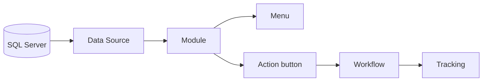

<div align="center">

# Rakit

**Build internal apps on SQL Server without writing a new page for every screen.**

[](https://dotnet.microsoft.com/)
[](https://learn.microsoft.com/aspnet/core/mvc/overview)
[](https://www.microsoft.com/sql-server)
[](#roadmap)

[Quick Start](#quick-start) · [Your First Page](#your-first-page) · [Concepts](#concepts) · [Configuration](#configuration) · [Roadmap](#roadmap)

</div>

---

Rakit is a low-code builder for internal applications backed by a single SQL Server database. You describe where the data comes from, how it should look, and what should happen when a button is pressed. Rakit turns that into working pages and workflows.

The name comes from the Indonesian word *merakit*, "to assemble": apps are put together from ready-made parts instead of written from scratch.



## Why Rakit

Most internal tools are the same handful of screens: a list with search and filters, a form to add or edit a record, a chart, a dashboard, and a few buttons that run a process. Rakit lets you configure those screens instead of coding them, while keeping SQL Server, and especially stored procedures, at the center.

- **Fast.** CRUD pages, reports, charts and dashboards come from configuration, not boilerplate.
- **SQL Server first.** One database, with stored procedures as a first-class data source.
- **Secure by default.** Parameterized SQL only, a stored procedure whitelist, least-privilege database users, and risky features switched off until you turn them on.
- **Traceable.** Every workflow run is recorded step by step.

## Features

- [x] **Data sources** from a table or view, a parameterized query, or a stored procedure (input, output, return value, multiple result sets)
- [x] **Table** module with search, filters, sorting, paging, add, edit, delete, detail view, and CSV export and import
- [x] **Form**, **Chart**, **Widget** and **Page** modules, where a Page can embed other modules to build a dashboard
- [x] **"Buat dari tabel" wizard** that generates the data sources, CRUD procedures, columns and form from one table
- [x] **Two-level menu** with folders and separators
- [x] **Workflows** on a visual canvas: Data Source, REST, Email, Page, Module, Condition, Javascript and Form steps, with an optional single SQL transaction
- [x] **Tracking** of every run with per-day charts and step details
- [x] **SQL Playground** with tabs, an object explorer and a table designer (read-only by default)
- [ ] Authentication and role-based access
- [ ] Scheduled workflows
- [ ] Audit log

## Tech Stack

| Layer | Technology |
|---|---|
| Runtime | .NET 10 (SDK 10.0.301), ASP.NET Core MVC with Razor views |
| Database | SQL Server 2016 SP1 or later (tested on SQL Server 2025 Express 17.0) |
| Data access | ADO.NET with Microsoft.Data.SqlClient 7.1.1 (no ORM) |
| Migrations | DbUp (dbup-sqlserver 7.2.0) |
| Workflow engine | Jint 4.17.0 (Javascript sandbox), MailKit 4.18.1 (email), HtmlSanitizer 9.2.1039 |
| Frontend | Bootstrap 5.3.3, Bootstrap Icons 1.11.3, jQuery 3.7.1, Chart.js 4.4.7, Ace Editor 1.36.5 |
| Testing | xUnit 2.9.3, Microsoft.NET.Test.Sdk 17.14.1 |

All frontend libraries are vendored in `src/Web/wwwroot/lib`, so no Node.js or CDN is required.

## Quick Start

### Prerequisites

- Windows 10/11 or Windows Server
- [.NET SDK 10.0](https://dotnet.microsoft.com/download)
- SQL Server 2016 SP1 or later (Express is enough), reachable as `.\SQLEXPRESS` by default
- A Windows account that can create databases on that instance

### Run it

```bash
# 1. Clone
git clone https://github.com/edrzvena/NetMvcRakit.git
cd NetMvcRakit

# 2. Create the database and apply all migrations
dotnet run --project db/Rakit.Migrations

# 3. Start the app
dotnet run --project src/Web
```

Open **http://localhost:5247**.

Using a different SQL Server instance? Pass the connection string to the migration runner and update `ConnectionStrings` in `src/Web/appsettings.Development.json`:

```bash
dotnet run --project db/Rakit.Migrations "Server=YOUR_SERVER;Database=Rakit;Integrated Security=true;TrustServerCertificate=true"
```

### Enable writes (optional)

Rakit starts in read-only mode. To try add, edit and delete on your development machine:

```powershell
# PowerShell
$env:Rakit__Db__AllowWrite = "true"
$env:Rakit__Playground__AllowWrite = "true"
dotnet run --project src/Web
```

> [!WARNING]
> Rakit has no login yet. Keep writes off, and never expose the app to the internet.

### Sample data (optional)

The migrations already create a small `app.Customers` table. For a richer playground with 21 tables and 2 views:

```bash
sqlcmd -S .\SQLEXPRESS -d Rakit -C -I -E -i db/Samples/sample-data.sql
```

## Your First Page

This walkthrough builds a customer list with add, edit and delete on top of `app.Customers`. Start the app with writes enabled first.

1. Open **Builder > Module** and click **Module baru**.
2. Name it `Customers` and choose the **Table** type.
3. Click **Buat dari tabel...**, pick `app.Customers`, review the columns and click **Terapkan**.
4. Click **Simpan**. The module is saved as a draft.
5. Back in the module list, click **Publish**.
6. Open **Builder > Menu**, add a menu item, set its target to the `Customers` module and save.

The new menu item now appears in the top bar and opens your page at `/object/page/{moduleId}`.

<details>
<summary><b>What the wizard did for you</b></summary>

- Created five data sources: `customers-list`, `customers-detail`, `customers-insert`, `customers-update` and `customers-delete`.
- Created the CRUD stored procedures if they did not exist yet (existing ones, such as `app.SpCustomers_Insert` from the migrations, are reused and never overwritten) and added them to the whitelist.
- Filled in the Display columns, the key field and the Form fields.

You can build the same thing by hand: create a data source in **Builder > Data Source**, then a Table module that uses it on the **Source** tab, configure the **Display** and **Form** tabs, and publish.

</details>

<details>
<summary><b>Next: add a workflow button</b></summary>

1. Open **Builder > Workflow** and create a workflow with the code `greet-customer`.
2. Add a **Data Source** step with the code `fetch` that uses `customers-detail`. Its `id` parameter is filled with the key of the clicked row.
3. Add a **Page** step after it:
   ```html
   <h5>Hello, {{fetch.row.Name}}</h5>
   <p>Registered email: {{fetch.row.Email}}</p>
   ```
4. Click **Periksa** to validate, save, then publish.
5. In the `Customers` module, add an action under **Aksi**, select `greet-customer` and tick **per baris**.

Every row now has a button that shows the customer's details. Each run is listed in **Builder > Tracking**.

</details>

## Concepts

| Concept | What it is |
|---|---|
| **Data Source** | How data is read or changed: a table, a query or a stored procedure, plus where each parameter value comes from. *Query* statements only read. *Command* statements write and need `AllowWrite`. |
| **Module** | How a data source is shown: Table, Form, Chart, Widget or Page. |
| **Draft / Published** | New modules and workflows are drafts. Only published ones are visible to users. |
| **Menu** | The navigation bar. Items point to a module or a URL. |
| **Workflow** | Steps that run when a button is pressed. Steps pass values to each other with placeholders such as `{{form.Email}}`, `{{key}}` and `{{fetch.row.Id}}`. |
| **Tracking** | The history of every workflow run, step by step. |
| **SP Whitelist** | The stored procedures Rakit may run. Anything else is refused. |

Business data lives in the `app` schema. Rakit keeps its own metadata in the `rakit` schema, which you should not edit by hand.

<details>
<summary><b>Workflow steps</b></summary>

| Step | What it does | Outputs |
|---|---|---|
| Data Source | Runs a query or stored procedure | `{{code.row.Column}}`, `{{code.out.Param}}`, `{{code.return}}` |
| REST | Calls an external API on an allowed host | `{{code.status}}`, `{{code.body}}`, `{{code.json.path}}` |
| Email | Sends an email over SMTP | `{{code.sent}}` |
| Page | Shows HTML to the user | |
| Module | Sends the user to another module | |
| Condition | Branches on a comparison | |
| Javascript | Runs a script in a server-side sandbox | `{{code.body}}`, `{{code.json.path}}` |
| Form | Pauses the run and asks the user for input (valid for 30 minutes) | `{{code.button}}`, `{{code.form.Field}}` |

Always available: `{{form.Field}}`, `{{key}}`, `{{claim.name}}` and `{{now}}`.

</details>

## Configuration

Settings live in `src/Web/appsettings.json` and `appsettings.Development.json`. Any key can be overridden with an environment variable by replacing `:` with `__`, for example `Rakit__Db__AllowWrite`.

| Key | Default | Description |
|---|---|---|
| `Rakit:Db:AllowWrite` | `false` | Allow *Command* data sources (add, edit, delete) |
| `Rakit:Db:AllowRawQuery` | `false` | Allow data sources written as raw SQL |
| `Rakit:Db:AllowStoredProcedure` | `true` | Allow stored procedure data sources |
| `Rakit:Db:AllowedSchemas` | `["app"]` | Schemas data sources may use |
| `Rakit:Playground:Enabled` | `false` (`true` in Development) | Show the SQL Playground |
| `Rakit:Playground:AllowWrite` | `false` | Let the Playground commit and the wizard create procedures |
| `Rakit:Workflow:AllowedHosts` | `[]` | Hosts a REST step may call, e.g. `api.example.com` |
| `Rakit:Mail:Host` | empty | SMTP server. When empty, emails are only logged |
| `Rakit:Security:BuilderLocalOnly` | `true` | Builder and Admin only open from the server itself |

<details>
<summary><b>All settings</b></summary>

**Connection strings**

| Key | Description |
|---|---|
| `ConnectionStrings:Metadata` | Reads and writes Rakit's metadata (`rakit` schema) |
| `ConnectionStrings:Execution` | Runs data sources (`app` schema). Must include `Pooling=false` |

**Rakit:Playground**

| Key | Default |
|---|---|
| `MaxRows` | `1000` |
| `TimeoutSeconds` | `30` |
| `MaxScriptLength` | `200000` |

**Rakit:Workflow:Script** (Javascript step sandbox)

| Key | Default |
|---|---|
| `TimeoutMs` | `500` |
| `MemoryLimitMb` | `16` |
| `MaxStatements` | `100000` |
| `MaxRecursion` | `100` |
| `MaxResultBytes` | `65536` |

**Rakit:Mail**

| Key | Default |
|---|---|
| `Host` / `Port` | empty / `25` |
| `Security` | `StartTlsWhenAvailable` |
| `User` / `Password` | empty (use user secrets or environment variables) |
| `From` / `FromName` | empty / `Rakit` |

</details>

## Security

Rakit connects with your Windows identity, then switches each connection to a login-less database user with only the permissions it needs:

| User | Can |
|---|---|
| `rakit_app` | Manage the `rakit` schema and read object definitions in `app` |
| `rakit_exec` | SELECT and EXECUTE in `app`, with no access to `rakit` |
| `rakit_play_ro` / `rakit_play` | Run Playground scripts, read-only or read-write |

On top of that:

- User input is always sent as SQL parameters, never concatenated into SQL.
- Stored procedures must be on the whitelist, checked on every call.
- Raw *Query* data sources are rolled back after they are read.
- Writes use anti-forgery tokens, and disabled buttons are refused by the server too.
- HTML from Page modules and workflow steps is sanitized.
- REST steps only reach allowed hosts and never follow redirects.
- Javascript steps run with time, memory and statement limits.

## Project Structure

```
NetMvcRakit/
├── db/
│   ├── Rakit.Migrations/   DbUp migration runner and SQL scripts
│   └── Samples/            Optional sample data
├── src/
│   ├── Core/               Data sources, modules, workflows, SQL execution
│   └── Web/                ASP.NET Core MVC app
│       └── Areas/
│           ├── Builder/    Module, Workflow, Tracking, Data Source, Menu, Playground
│           ├── Admin/      SP Whitelist, Health
│           └── Object/     Runtime pages (/object/page/{id})
└── tests/
    └── Rakit.Core.Tests/   xUnit tests
```

## Testing

```bash
dotnet test Rakit.slnx
```

Tests create their own `Rakit_Test` database on `.\SQLEXPRESS` and leave `Rakit` untouched. Set `RAKIT_TEST_CONN` to use another server.

## Roadmap

- [x] Data sources, modules, menu, workflows, tracking, playground
- [ ] Authentication and role-based access per module
- [ ] Scheduled workflows
- [ ] Audit log and log viewer

Rakit is in early development and is not ready for production.

<details>
<summary><b>Troubleshooting</b></summary>

| Problem | Fix |
|---|---|
| Migration cannot connect | Check that SQL Server is running and pass the right connection string. |
| Migration cannot create the database | Your Windows account needs the `dbcreator` role. |
| `MetadataConnectionString is required` on startup | Run in the `Development` environment, or fill in `ConnectionStrings`. |
| Builder returns HTTP 403 | Open it from the machine the app runs on (`BuilderLocalOnly`). |
| Add, edit or delete buttons are missing | Enable `AllowWrite`, choose the Insert/Update/Delete data sources, set the key field, and check the buttons on the Display tab. |
| Module page returns 404 | The module is still a draft. Publish it. |
| Stored procedure refused | Add it in **Admin > SP Whitelist**. |
| REST step is "not available" | Add the host to `Rakit:Workflow:AllowedHosts`. |
| Emails are not sent | Set `Rakit:Mail:Host`. |

</details>
